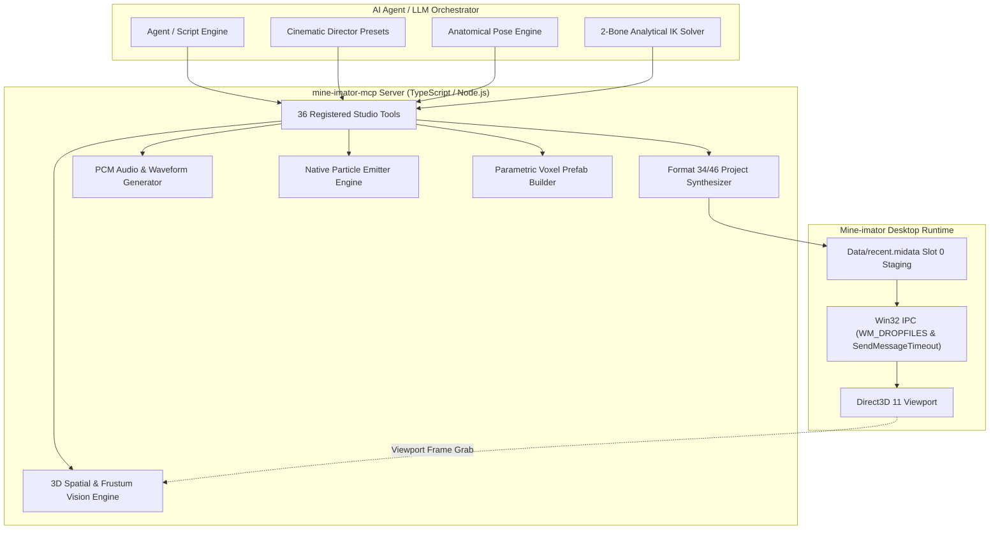

# Mine-imator Model Context Protocol (MCP) Server v2.0
[](https://www.typescriptlang.org/)
[](https://modelcontextprotocol.io/)
[]()
[](https://vexelmineimator.com/)

An enterprise-grade **Model Context Protocol (MCP)** server enabling AI agents and LLMs to orchestrate, rig, animate, direct, and synthesize broadcast-quality 3D Minecraft cinematics inside **Mine-imator 2.0.2** and **Mine-imator Vexel Build v1.3.2**.

Reverse-engineered directly from 64-bit Direct3D 11 / Qt 5.15 Mine-imator host architectures with closed-loop desktop IPC, analytical 2-bone Inverse Kinematics, 3D spatial vision, and parametric voxel scenery synthesis.

---

## Architecture Overview



---

## Key Capabilities

1. **Analytical 2-Bone Inverse Kinematics (IK)**:
   - Closed-form analytical trigonometric solver for character arms and legs ($[0^\circ, 140^\circ]$ joint limits).
   - Parent Forward Kinematics (FK) coordinate normalization.
   - Gram-Schmidt orthonormal fallback basis preventing gimbal-lock singularities.

2. **3D Spatial Awareness & Frustum Vision**:
   - 3D camera coordinate projection (Camera Pitch/Yaw/Roll transform matrix).
   - 8-corner Oriented Bounding Box (OBB) frustum visibility testing with near-plane clipping.
   - Rule-of-Thirds framing zones, camera distance matrix, and ground-contact validation.

3. **Hollywood Cinematic Director**:
   - 6 dedicated shot cameras (Macro, Close-Up, Over-the-Shoulder, Medium, Wide, Crane/God's-Eye).
   - Vertigo Dolly-Zoom solver ($\text{FOV}(t)$ dynamically compensating for camera distance).
   - Procedural camera shake (Dutch roll, tremor frequency, and decay envelopes).

4. **Voxel Architecture & Scenery Synthesis**:
   - Parametric block prefabs: Cottage Porch, Birch Hill, Burnt Cottage Ruins, Griefer Skybase, Bedrock Void.
   - High-throughput block clustering with clean timeline hierarchies and parent tree indexing.

5. **Audio & Sound FX Engine**:
   - Audio timeline tracks with volume envelopes and spatial panning.
   - Native WAV PCM generator producing 44.1kHz stereo audio stubs for instant in-timeline playback.

6. **Desktop IPC & Live Viewport Sync**:
   - Zero-click live updates via Win32 `WM_DROPFILES` (0x0233) injection and `Data/recent.midata` slot 0 staging.
   - `PrintWindow(PW_RENDERFULLCONTENT)` Direct3D 11 swapchain viewport frame grab.

---

## Tool Catalog (36 Tools)

### 1. Scene Synthesis & Project I/O
- `mineimator_create_project`: Scaffold fresh `.miproject` (Format 34/46) with custom FPS, resolution, render settings.
- `mineimator_read_project`: Parse project structure, entities, keyframes, cameras, and asset references.
- `mineimator_set_environment`: Configure sun position, sky gradients, fog, wind, and clouds.
- `mineimator_set_render_pipeline`: Configure SSAO, volumetric shadows, raytraced reflections, bloom, and AA.
- `mineimator_validate_project`: Lint project for orphaned body parts, missing IDs, or corrupt transitions.

### 2. Rigging & Anatomical Entities
- `mineimator_add_character`: Spawn Minecraft character (`human`, `zombie`, etc.) with full 7-part hierarchy.
- `mineimator_add_block`: Insert 3D block with custom texture and state (stairs, doors, redstone).
- `mineimator_add_item`: Insert item (swords, tools) with realistic hand grip orientation and elbow bend inheritance.
- `mineimator_add_light`: Place point or spotlights with custom color, range, and shadow attenuation.
- `mineimator_add_camera`: Create cinematic camera with custom FOV, target tracking, and depth of field.

### 3. Procedural Motion & Keyframing
- `mineimator_insert_keyframe`: Set position, rotation, scale, bend, alpha, and transition easing at any frame.
- `mineimator_generate_walk_cycle`: Compute natural sinusoidal limb swings, torso counter-rotation, and vertical bob.
- `mineimator_generate_camera_path`: Generate smooth Catmull-Rom spline paths with automatic Look-At target angles.
- `mineimator_clear_keyframes`: Wipe or trim keyframes across specified timelines and frame windows.

### 4. Advanced Inverse Kinematics & Posing
- `mineimator_solve_ik`: Compute arm/leg joint angles from 3D shoulder/hip to target wrist/ankle.
- `mineimator_apply_ik`: Apply analytical IK solution directly to a character's limb at a specific frame.
- `mineimator_apply_pose_preset`: Apply one of 15 studio poses (`sword_slash`, `block_shield`, `crawl`, `levitate_god`, `griefer_twerk`, etc.).
- `mineimator_list_pose_presets`: Inspect the complete anatomical pose catalog.

### 5. Particle Systems & VFX
- `mineimator_add_particle_spawner`: Create custom 3D particle emitter nodes with velocity and lifetime curves.
- `mineimator_spawn_vfx_preset`: Spawn cinematic VFX (`volumetric_fire`, `smoke_plume`, `tnt_explosion`, `xp_orbs_dissolve`, `orbital_laser_beam`).

### 6. Parametric Scenery & Structures
- `mineimator_build_structure_prefab`: Procedurally build voxel structures (`cottage_porch`, `birch_hill`, `burnt_cottage_ruins`, `griefer_skybase`, `bedrock_void`).
- `mineimator_create_scene_set`: Generate segregated 3D scene set at spatial coordinates with dedicated camera.

### 7. Sound Design & Audio
- `mineimator_add_audio_track`: Insert synchronized sound effect or music track with volume envelopes.
- `mineimator_generate_sound_stub`: Synthesize PCM WAV audio stubs (`impact`, `laser`, `piano_chord`, `ambient_drone`).

### 8. Hollywood Director & Cameras
- `mineimator_create_director_camera`: Spawn specialized shot cameras with Hollywood framing presets (`close_up`, `wide`, `over_the_shoulder`, `gods_eye_crane`).
- `mineimator_generate_dolly_zoom`: Calculate Vertigo camera dolly-zoom preserving subject size while shifting background FOV.
- `mineimator_add_camera_shake`: Inject handheld or seismic camera shake with decay envelopes.
- `mineimator_switch_shot_camera`: Switch active viewport camera at cut frame boundaries.

### 9. 3D Spatial Awareness & Vision
- `mineimator_project_to_camera_view`: Compute 2D normalized viewport coordinates $(X, Y)$ and depth $Z$ from world 3D position.
- `mineimator_inspect_scene_vision`: Inspect camera frustum visibility, bounding boxes, Rule-of-Thirds framing, and ground contact.
- `mineimator_validate_ground_contact`: Detect character ground float or mesh penetration.
- `mineimator_calculate_distance_matrix`: Measure 3D and 2D distances between all entities in the scene.

### 10. Assets & Desktop Automation Bridge
- `mineimator_list_minecraft_assets`: Query blocks, items, particles, and models from Minecraft midata libraries.
- `mineimator_import_schematic`: Attach `.schematic` world files into the scene as scenery timelines.
- `mineimator_stage_for_launch`: Pin project to slot 0 in `Data/recent.midata` across detected installations.
- `mineimator_open_via_drop`: Bring running Mine-imator window to foreground and post `WM_DROPFILES`.
- `mineimator_capture_viewport`: Capture Direct3D viewport screenshot via Win32 GDI with process filtering.
- `mineimator_live_reload`: Hot-reload running Mine-imator instance with live project updates.
- `mineimator_export_video`: Automate rendering via UIAutomation or patched CLI build.

---

## Verification & Test Suite

The test suite runs with native Node.js test runner (`node --test`) and covers 100% of mathematical solvers and schema validators:

```bash
npm test
```

```
TAP version 13
# tests 107
# suites 17
# pass 107
# fail 0
# cancelled 0
# skipped 0
# duration_ms 15001
```

---

## Production Demo Animation

The included master script `build-steves-revenge.mjs` generates the full 60-second multi-scene production animation **"STEVE'S REVENGE: SERVER WIPE"**:

- **Duration:** 1,440 frames (60.0s @ 24 FPS)
- **Entities:** 120 timeline tracks, 4 characters (Steve, Alex, 2 Griefers), 7 voxel structures, 6 dedicated director shot cameras, 8 audio tracks, and 5 particle emitters.
- **Run generator:**
  ```bash
  node build-steves-revenge.mjs
  ```

---

## MCP Server Integration

Add to your MCP client configuration (`claude_desktop_config.json` or `mcp_config.json`):

```json
{
  "mcpServers": {
    "mine-imator": {
      "command": "node",
      "args": [
        "C:\\Users\\RocKeR\\.gemini\\antigravity\\scratch\\mine-imator-mcp\\dist\\index.js"
      ]
    }
  }
}
```

---

## License
MIT License. Created for the Advanced Agentic Coding Ecosystem.
