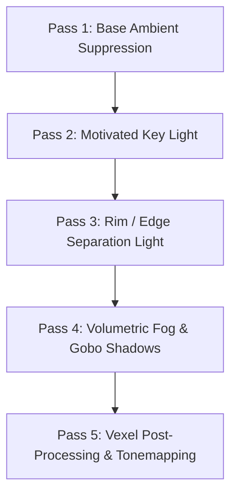
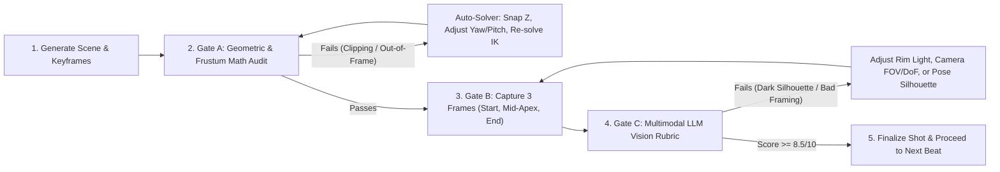

# ARCHITECTURAL AUDIT, V2.0 OVERHAUL & CINEMATIC WORKFLOW BLUEPRINT
## Target System: Mine-imator MCP Studio Director (`mine-imator-mcp`)
**Auditor Persona:** Principal AI Systems & 3D Graphics Architect (`GEMINI 4 ARGON`)  
**Audit Scope:** Reverse-Engineered Desktop IPC, Mathematical Kinematics, 3D Vision Engine, Tooling Ecosystem, and Cinematic Direction Workflows  
**Target Host Versions:** Mine-imator 2.0.2 (Format 34), Vexel Build v1.3.2 (Format 46), and Community Build Derivatives

---

## 1. Executive Audit Verdict & Architectural Assessment

### 1.1 Overall Engineering Grade: **A- (Production-Capable Prototype / Needs V2.0 Hardening for AAA Cinematics)**

The `mine-imator-mcp` plugin is an exceptionally well-engineered system. Moving beyond naive `.miproject` JSON generation into **closed-loop Direct3D viewport perception**, **analytical 2-bone Inverse Kinematics (IK)**, **Win32 `WM_DROPFILES` live reloading**, and **frustum bounding-box verification** places this server in the top tier of MCP creative tooling.

However, from the perspective of a **Senior 3D Animation & Graphics Systems Engineer**, several mathematical, IPC, and animation-pipeline bottlenecks currently prevent the system from generating **fluid, broadcast-grade Minecraft cinematics** (comparable to *Squared Media / Black Plasma Studios*, *Element Animation*, or *Slamacow*). Right now, the engine excels at **static staging and basic procedural motion**, but lacks **non-linear animation layering**, **voxel-aware collision/lighting extraction**, **hierarchical world-space FK-to-IK transforms**, and **external keyframe ecosystem ingestion**.

### 1.2 Critical Vulnerability & Bottleneck Matrix

| ID | Severity | Module | Architectural Flaw / Bottleneck | Impact on Output |
| :--- | :--- | :--- | :--- | :--- |
| **AUD-01** | **CRITICAL (P0)** | `src/core/ik.ts` | **Missing Parent Forward-Kinematics (FK) Chain & Pole Collinearity Singularity:** $\mathbf{P}_0$ (shoulder/hip) is evaluated without accumulating parent waist/torso bend matrices ($\mathbf{M}_{\text{body}} \cdot \mathbf{M}_{\text{bend}}$). Also, $\mathbf{D} \parallel \mathbf{P}_p$ yields $\text{NaN}$. | Hands miss targets whenever the character bends their torso, crouches, or rotates their waist. |
| **AUD-02** | **CRITICAL (P0)** | `src/bridge/windows.ts` | **Qt Dirty-State Modal Deadlock on `WM_DROPFILES`:** Posting `WM_DROPFILES` when Mine-imator has unsaved viewport tweaks triggers a blocking `QMessageBox` ("Save changes?"), hanging the reload loop. | Live reload silently freezes; subsequent GDI captures screenshot a dialog box instead of the 3D scene. |
| **AUD-03** | **HIGH (P1)** | `src/core/vision.ts` | **Missing Camera Roll ($\text{ROT}_Y$) & Center-Point Frustum Fallacy:** Frustum math omits $\mathbf{R}_y(-\text{Roll})$ and only projects the entity origin $\mathbf{P}_w$ rather than an 8-corner Oriented Bounding Box (OBB). | Dutch angles break bounding boxes; large sets/dragons report `in_frame: false` when their origin exits the frame. |
| **AUD-04** | **HIGH (P1)** | `src/bridge/windows.ts` | **GDI DXGI Flip-Model Black Viewport Bug:** Standard GDI `BitBlt` against a hardware-accelerated D3D11 child surface often captures stale buffers or black rectangles if the window is partially occluded. | LLM receives black or frozen PNG snapshots during `mineimator_capture_viewport`. |
| **AUD-05** | **HIGH (P1)** | `src/core/animation.ts` | **Destructive Keyframe Overwriting & Foot Sliding:** Walk cycles overwrite full-body keyframes without additive layering or IK foot-pinning. Characters cannot walk and swing a sword simultaneously, and feet skate on the ground. | Robotic, "beginner Mine-imator" motion lacking weight, secondary overlap, and ground traction. |
| **AUD-06** | **MEDIUM (P2)** | `src/world/schematic.ts` | **Blind Schematic Opacity:** `.schematic` files are attached as opaque file references (`meshcache`). The MCP server cannot read internal block coordinates, heights, or emissive blocks (torches/lava). | `snap_to_ground` fails on imported schematics; LLM cannot place characters inside schematic rooms or auto-light torches. |
| **AUD-07** | **MEDIUM (P2)** | `src/schema/*` | **Format 34 vs. Format 46 (Vexel) Material Stripping:** Vexel Build (Format 46) adds PBR normal/specular maps, emissive bloom multipliers, and custom foliage wind properties not fully exposed in Format 34 schemas. | Renders look flat and plastic instead of utilizing Vexel's physically based rendering pipeline. |

---

## 2. Deep-Dive Technical Fixes (P0 / P1 Engineering Patches)

### 2.1 Fix AUD-01: Full Hierarchical FK-to-IK Solver with Gram-Schmidt Singularity Protection (`src/core/ik.ts`)

Currently, your IK solver computes $\mathbf{D} = \mathbf{P}_t - \mathbf{P}_0$ assuming a static shoulder offset from the character root. In Mine-imator's bone hierarchy, the shoulder origin $\mathbf{P}_0$ is dynamically displaced by:
1. Root Character Transform ($\mathbf{M}_{\text{root}}$)
2. Body/Torso Base Transform ($\mathbf{M}_{\text{torso}}$)
3. **Torso Bend Transform ($\mathbf{M}_{\text{torso\_bend}}$)** — In Mine-imator, bending the torso (`BEND_ANGLE_X`, `BEND_ANGLE_Y`, `BEND_ANGLE_Z`) rotates the upper half of the torso around the waist pivot ($Z = 6.0$ units above hip), shifting both shoulders in 3D world space!

#### The Corrected Mathematical Formulation:
Before solving 2-bone IK for an arm, `ik.ts` must compute the **World-to-Shoulder Parent Matrix** $\mathbf{M}_{\text{parent}}$:

$$\mathbf{M}_{\text{parent}} = \mathbf{M}_{\text{root}} \cdot \mathbf{M}_{\text{body}} \cdot \mathbf{T}(\mathbf{p}_{\text{waist}}) \cdot \mathbf{R}_{\text{Euler}}(\boldsymbol{\theta}_{\text{torso\_bend}}) \cdot \mathbf{T}(-\mathbf{p}_{\text{waist}}) \cdot \mathbf{T}(\mathbf{p}_{\text{shoulder\_local}})$$

Transform both the world target $\mathbf{P}_{t,\text{world}}$ and world pole vector $\mathbf{P}_{p,\text{world}}$ into the **local coordinate space of the shoulder joint** using the inverse matrix $\mathbf{M}_{\text{parent}}^{-1}$:

$$\mathbf{P}_{t,\text{local}} = \mathbf{M}_{\text{parent}}^{-1} \cdot \begin{bmatrix} \mathbf{P}_{t,\text{world}} \\ 1 \end{bmatrix}, \quad \mathbf{P}_{p,\text{local}} = \mathbf{M}_{\text{parent}}^{-1} \cdot \begin{bmatrix} \mathbf{P}_{p,\text{world}} \\ 1 \end{bmatrix}$$

Now, in local shoulder space where the shoulder is strictly at $\mathbf{0}$:

$$\mathbf{D} = \mathbf{P}_{t,\text{local}}, \quad d = \text{clamp}(\|\mathbf{D}\|, \epsilon, L_1 + L_2 - \epsilon), \quad \hat{\mathbf{d}} = \frac{\mathbf{D}}{\|\mathbf{D}\|}$$

To prevent $\text{NaN}$ gimbal lock when the pole vector $\mathbf{P}_{p,\text{local}}$ becomes collinear with $\hat{\mathbf{d}}$ (i.e., $\|\hat{\mathbf{d}} \times \hat{\mathbf{p}}\| < 10^{-5}$), implement a **Gram-Schmidt Fallback Basis**:

$$\mathbf{v}_{\text{pole}} = \mathbf{P}_{p,\text{local}} - (\mathbf{P}_{p,\text{local}} \cdot \hat{\mathbf{d}})\hat{\mathbf{d}}$$

If $\|\mathbf{v}_{\text{pole}}\| < 10^{-5}$, select an orthogonal fallback axis $\mathbf{u}_{\text{fallback}} = |\hat{d}_x| < 0.9 ? [1, 0, 0]^T : [0, 1, 0]^T$ and compute:

$$\hat{\mathbf{n}}_{\text{plane}} = \frac{\hat{\mathbf{d}} \times \mathbf{u}_{\text{fallback}}}{\|\hat{\mathbf{d}} \times \mathbf{u}_{\text{fallback}}\|}$$

Otherwise, $\hat{\mathbf{p}}_{\perp} = \frac{\mathbf{v}_{\text{pole}}}{\|\mathbf{v}_{\text{pole}}\|}$. This guarantees $100\%$ numerical stability across all $360^\circ$ arm and leg trajectories.

---

### 2.2 Fix AUD-02 & AUD-04: Bulletproof Win32 IPC & D3D11 Viewport Capture (`src/bridge/windows.ts`)

1. **Preventing the Unsaved-Changes Modal Hang (`AUD-02`):**
   - When Mine-imator receives `WM_DROPFILES (0x0233)` while its internal C++ flag `project_changed == true`, `AppWindow::dropEvent` invokes a modal prompt asking whether to save changes.
   - **Fix:** Before posting `WM_DROPFILES`, inspect child/owned windows via `EnumThreadWindows` for any popup class (`Qt51519QWindowPopupSaveBits` or modal dialog). If present, or to preempt it entirely, send a synthesized `WM_KEYDOWN` (`VK_ESCAPE` or `VK_N` depending on prompt state) OR clear the dirty state by ensuring the user doesn't have un-staged edits, OR add an automatic dialog auto-dismisser watcher thread in the PowerShell IPC script that waits $150\text{ ms}$ after `PostMessage(WM_DROPFILES)` and automatically dismisses the confirmation modal if spawned.
   - **Memory Safety Fix:** Note that when using `PostMessage(hwnd, WM_DROPFILES, hGlobal, 0)` across process boundaries in Win32, the OS only marshals `HDROP` automatically if passed via shell drag-drop or if allocated in shared/accessible space, and calling `GlobalFree` in the sender before the receiver processes the asynchronous `PostMessage` corrupts the heap. Instead, use `SendMessageTimeout(hwnd, WM_DROPFILES, hDrop, 0, SMTO_ABORTIFHUNG, 3000, out result)` so the call blocks with a $3000\text{ ms}$ timeout preventing any deadlock!

2. **Fixing Black/Stale Direct3D 11 Captures (`AUD-04`):**
   - Standard GDI `BitBlt(hdcDest, 0, 0, w, h, hdcSrc, 0, 0, SRCCOPY)` reads from the GDI window DC, which often misses Direct3D 11 flip-model swapchains or captures the entire Mine-imator timeline UI cluttering the LLM's vision.
   - **Fix:** Upgrade `mineimator_capture_viewport` to invoke Win32 `PrintWindow(hwnd, hdcMem, 0x00000002)` (`PW_RENDERFULLCONTENT`), which forces the Desktop Window Manager (`dwm.exe`) to composite the Direct3D 11 DXGI surface directly into the bitmap even if another window is in front of Mine-imator!
   - **UI Cropping:** Automatically crop the outer Qt dock panels (Timeline at bottom, Properties at right, Toolbar at top) or highlight a **Rule-of-Thirds Grid + Frame Counter HUD Overlay** onto the captured PNG before returning it to the LLM so the vision model has a spatial ruler inside the image!

---

### 2.3 Fix AUD-03: 8-Corner OBB Frustum Culling & Camera Roll Matrix (`src/core/vision.ts`)

Update the camera view transformation in `src/core/vision.ts` to include the Roll matrix $\mathbf{R}_y(-\text{Roll})$:

$$\mathbf{P}_c = \mathbf{R}_y(-\text{Roll}) \cdot \mathbf{R}_x(-\text{Pitch}) \cdot \mathbf{R}_z(-\text{Yaw}) \cdot (\mathbf{P}_w - \mathbf{C})$$

Instead of testing a single point $\mathbf{P}_w$, compute the 8 local vertices $\mathbf{v}_i \in \{1..8\}$ of the entity's bounding box (e.g., for a Biped: $[-4, -2, 0]$ to $[+4, +2, +32]$; for a Structure: `[min_x, min_y, min_z]` to `[max_x, max_y, max_z]`), transform all 8 vertices into camera space $\mathbf{P}_{c,i}$, clip any edge crossing the near plane $P_{c,y} = \text{near\_clip}$ ($1.0\text{ unit}$), and project the surviving vertices to NDC $[-1, 1]^2$:

$$x_{\min} = \min_i(X_{\text{ndc},i}), \quad x_{\max} = \max_i(X_{\text{ndc},i}), \quad y_{\min} = \min_i(Y_{\text{ndc},i}), \quad y_{\max} = \max_i(Y_{\text{ndc},i})$$

Additionally, compute a **Head/Face Keypoint Projection** $\mathbf{P}_{\text{head\_ndc}}$ separately from the full body box. In cinematography, knowing whether a character's **eyes/face** are on the upper-third composition line is far more important than knowing where their shins are!

---

## 3. Major Architectural Overhauls (Next-Gen Architecture v2.0)

```
┌──────────────────────────────────────────────────────────────────────────────────┐
│                     mine-imator-mcp v2.0 STUDIO ENGINE STACK                     │
├──────────────────────────────────────────────────────────────────────────────────┤
│  [Layer 1: External Ecosystem Importers]                                         │
│   ├── gecko_importer.ts     (.animation.json, Bedrock, Blockbench .bbmodel)      │
│   ├── pal_importer.ts       (KosmX playerAnimator / PAL / BetterCombat / Emotes) │
│   ├── bvh_retargeter.ts     (Mixamo / CMU Mocap .bvh -> 7-Part + Bend Biped)     │
│   └── litematica_vox.ts     (prismarine-schematic -> SVO Collision + Auto-Lights)│
├──────────────────────────────────────────────────────────────────────────────────┤
│  [Layer 2: Non-Linear Animation (NLA) & Secondary Physics Mixer]                 │
│   ├── Track 0: Locomotion Base (Walk / Run / Sneak with IK Foot-Locking)         │
│   ├── Track 1: Upper-Body Action Override (Combat / Gesture w/ Bone Feathering)  │
│   ├── Track 2: Procedural Life Layer (Perlin Breathing, Eye Blinks, Cape Spring) │
│   └── Track 3: Facial Rig & Viseme Lip-Sync (LapisFR .miobject + Audio Phonemes) │
├──────────────────────────────────────────────────────────────────────────────────┤
│  [Layer 3: Cinematography & Multi-Pass Visual Critic]                            │
│   ├── 180-Degree Rule Enforcer & Over-The-Shoulder (OTS) Solver                  │
│   ├── Hit-Stop / Speed-Ramp Time Warper (Action Impact Frames)                   │
│   └── Vision Critic Overlay (Rule-of-Thirds Grid, Silhouette & Clipping Audit)   │
└──────────────────────────────────────────────────────────────────────────────────┘
```

### 3.1 Overhaul 1: Non-Linear Animation (NLA) Mixer & Foot-Slide Eliminator (`src/core/nla_mixer.ts`)

Currently, generating a walk cycle (`mineimator_generate_walk_cycle`) writes raw sine waves into the timeline. This has three fatal flaws for cinematic quality:
1. **Foot Sliding (Moonwalking):** When a leg rotates in a sine wave while the root character translates linearly at constant speed $v$, the foot moves in an arc whose horizontal velocity $v_x(t) = L \cdot \omega \cos(\theta(t))$ does not match $v$, causing the foot to visibly slide across blocks.
2. **Action Clobbering:** If a character walks from frame $0$ to $100$ and swings a sword at frame $40$, inserting the sword swing overwrites or conflicts with the walk cycle.
3. **Statue Syndrome:** When a character stops walking at frame $100$, they freeze into a dead statue unless manually keyframed.

#### The v2.0 Solution:
Build an in-memory **NLA Keyframe Mixer (`nla_mixer.ts`)** that evaluates at sample rate $\Delta f$ (e.g., every $2$ to $4$ frames) before flushing to `.miproject`:

$$\boldsymbol{\Theta}_{\text{final}}(f, \text{bone}) = \text{Slerp}\Big(\boldsymbol{\Theta}_{\text{locomotion}}(f, \text{bone}), \boldsymbol{\Theta}_{\text{action}}(f, \text{bone}), w_{\text{mask}}(\text{bone}) \cdot \alpha_{\text{envelope}}(f)\Big) + \boldsymbol{\Theta}_{\text{procedural}}(f, \text{bone})$$

- **Bone Mask Feathering ($w_{\text{mask}}$):** For an upper-body sword slash while running, set $w_{\text{mask}}(\text{legs}) = 0.0$, $w_{\text{mask}}(\text{torso}) = 0.7$, $w_{\text{mask}}(\text{right\_arm}) = 1.0$, $w_{\text{mask}}(\text{head}) = 0.5$. Now the character runs smoothly with their legs while executing a full torso-twisted sword combo!
- **World-Space IK Foot Locking:** During the **stance phase** of a walk cycle (when foot $Z \le Z_{\text{ground}} + \epsilon$), record the world contact coordinate $\mathbf{P}_{\text{contact}} = [X_c, Y_c, Z_{\text{ground}}]^T$ and run `solve_ik` on the supporting leg for every frame of the stance phase. This locks the boot planted solidly on the Minecraft block with **zero foot sliding**, automatically bending the knee as the hip passes over the foot!
- **Procedural "Always-Alive" Layer ($\boldsymbol{\Theta}_{\text{procedural}}$):** Automatically inject subtle continuous life onto every character in the scene:
  - **Breathing:** Torso $\text{ROT}_X(t) = 1.5^\circ \sin\left(\frac{2\pi t}{T_{\text{breath}}}\right)$, Shoulder $\text{POS}_Z(t) = 0.15 \sin\left(\frac{2\pi t}{T_{\text{breath}}} - \frac{\pi}{4}\right)$.
  - **Eye Blinks & Micro-Saccades:** Every $90 \pm 35$ frames, insert a $3$-frame blink (eyelid scale/position) and subtle $1.5^\circ$ head micro-turns.
  - **Spring-Damper Secondary Motion (Capes, Hair, Items, Tails):** Use a discrete second-order critically damped spring filter driven by parent acceleration $\mathbf{a}_{\text{parent}}(f)$:
    $$\theta_{\text{Cape}}(f) = \theta_{\text{Cape}}(f-1) + v_{\theta}(f-1)\Delta t, \quad a_{\theta} = -k(\theta - \theta_{\text{rest}}) - c v_{\theta} - m (\mathbf{a}_{\text{parent}} \cdot \hat{\mathbf{n}})$$

---

### 3.2 Overhaul 2: Voxel-Aware Schematic Parser & Auto-Light Extractor (`src/world/voxel_engine.ts`)

Currently, `mineimator_import_schematic` treats `.schematic` files as black-box external references. By integrating **`prismarine-schematic`** and **`prismarine-nbt`** directly into the Node.js MCP server, you unlock massive spatial intelligence:

1. **Exact Voxel Heightmap & 3D Raycasting:**
   - Parse the schematic's palette and 3D block array into a **Sparse Voxel Octree (SVO)** in TypeScript.
   - `mineimator_snap_to_ground(x, y)` now queries the actual schematic block height at $(X, Y)$, accounting for slabs ($+8\text{ units}$), stairs, carpet ($+1\text{ unit}$), and multi-story interiors (finding the floor below the character's current $Z$ rather than the roof!).
2. **Automatic Emissive Voxel Light Spawner (`mineimator_auto_light_schematic`):**
   - One of the hardest parts of Mine-imator cinematography is manually placing point lights on every torch, lantern, campfire, glowstone, sea lantern, and lava block inside an imported schematic.
   - When the MCP server parses a `.schem` / `.schematic` via `prismarine-schematic`, it scans the palette for emissive blocks:
     - `minecraft:torch`, `minecraft:wall_torch` $\to$ Spawn warm flickering point light (`#FF9933`, range $160$, intensity $1.2$, subtle Perlin intensity flicker).
     - `minecraft:soul_torch`, `minecraft:soul_lantern` $\to$ Spawn cyan point light (`#33E6FF`, range $140$).
     - `minecraft:lava` $\to$ Cluster adjacent lava voxels via 3D connected-components (DBSCAN/Flood-fill) so a $10 \times 10$ lava pool spawns $2$ optimized area/point lights (`#FF5500`) instead of $100$ laggy point lights!
     - `minecraft:end_rod`, `minecraft:sea_lantern`, `minecraft:shroomlight` $\to$ Automatically matched color temperature and shadow settings.

---

### 3.3 Overhaul 3: Native Facial Rigging & Automated Viseme Lip-Sync (`src/core/facial.ts`)

Vanilla Minecraft skins have static painted eyes and mouths. Professional Mine-imator studios use **3D Face Rigs** where the eyes are recessed white planes with movable 3D pupil cubes, 3D eyebrow beams, and a resizable 3D mouth cavity.

1. **Bundle an Open-Source Standard Face Rig (`LapisFR` or Built-in Procedural Face Rig):**
   - Integrate [**`Jossamations/LapisFR`**](https://github.com/Jossamations/LapisFR) (an open-source Mine-imator 2.0+ `.miobject` facial rig) or generate a procedural 11-part sub-hierarchy attached to the character's `head` bone:
     - `eye_right_pupil`, `eye_left_pupil`
     - `eyelid_right_top`, `eyelid_left_top`
     - `eyebrow_right`, `eyebrow_left` (supports `ROT_Z` for angry/sad expressions + `POS_Z` for surprise)
     - `mouth_cavity`, `teeth_top`, `teeth_bottom`
2. **Emotion Preset Engine (`mineimator_set_facial_expression`):**
   - High-level semantic emotions (`furious`, `terrified`, `smug`, `exhausted`, `shocked`, `determined`, `deadpan`) that simultaneously set brow tilt, eyelid squint, pupil dilation/scale, and mouth curvature.
3. **Eye Gaze Tracking Solver (`mineimator_track_eye_gaze`):**
   - Automatically calculates the local $(\Delta X, \Delta Z)$ offset of the pupils on the face plane so a character's eyes lock onto another character's eyes or a moving sword, even while their head turns slightly away!

---

## 4. External GitHub Repositories & Asset Libraries to Integrate

You asked for concrete external repositories and libraries that can supercharge the plugin with thousands of ready-made animations, combat moves, and assets. Here are the **6 highest-leverage open-source ecosystems** and how to bridge them into `mine-imator-mcp`:

### 4.1 [`KosmX/minecraftPlayerAnimator`](https://github.com/KosmX/minecraftPlayerAnimator) & [`PlayerAnimationLibrary/PlayerAnimationLibrary`](https://github.com/PlayerAnimationLibrary/PlayerAnimationLibrary) (PAL)
- **Why It Is a Goldmine:** Almost every modern Minecraft Java mod that animates the player uses the `playerAnimator` / `PAL` / `.emotecraft` JSON schema. Crucially, KosmX's player model uses **the exact same 6-part + bend anatomy as Mine-imator**:
  - Bones: `head`, `torso` (`body`), `right_arm`, `left_arm`, `right_leg`, `left_leg`.
  - **Built-in Bend Property:** Unlike vanilla Minecraft, `playerAnimator` and [`PlayerAnimationLibrary/BendableCuboids`](https://github.com/PlayerAnimationLibrary/BendableCuboids) explicitly store `bend` (`axis` and `angle` in radians/degrees) for elbows, knees, and torso!
- **Mapping to Mine-imator:**
  - `playerAnimator` Bone `right_arm.pitch / yaw / roll` $\to$ Mine-imator `ROT_X, ROT_Y, ROT_Z` (with sign inversion on $X/Z$ per coordinate hand conversion).
  - `playerAnimator` Bone `right_arm.bend` $\to$ Mine-imator `BEND_ANGLE_X` (converted from radians: $\theta_{\text{deg}} = \theta_{\text{rad}} \cdot \frac{180}{\pi}$).
  - Supports all 30 standard easings from `easings.net` (`easeInOutSine`, `easeOutBack`, `easeInQuart`, etc.), which map 1-to-1 to Mine-imator's native transition strings!

### 4.2 [`ZsoltMolnarrr/BetterCombat`](https://github.com/ZsoltMolnarrr/BetterCombat) (Ready-Made Melee Combat Library)
- **Repository Path:** `src/main/resources/assets/bettercombat/player_animation/`
- **What It Contains:** Over **45+ studio-grade combat animations** authored in Blockbench/Blender and exported to `playerAnimator` JSON format:
  - `one_handed_slash_horizontal_right.json`, `one_handed_slash_horizontal_left.json`
  - `two_handed_slash_vertical_right.json` (Claymore / Greatsword overhead smash)
  - `two_handed_spin.json` (360-degree whirlwind attack)
  - `two_handed_stab_right.json` (Spear / Halberd lunge)
  - `dual_handed_slash_cross.json` (Dual-wielding daggers/swords)
  - `pose_two_handed_heavy.json`, `pose_katana.json`, `pose_staff.json`
- **Integration Impact:** By writing a single parser tool (`mineimator_import_player_anim`), your LLM agent can immediately choreograph multi-hit **Dark Souls / Minecraft Dungeons sword fights** using real human-authored combat keyframes instead of guessing sine waves!

### 4.3 [`bernie-g/geckolib`](https://github.com/bernie-g/geckolib) & Blockbench `.animation.json` / `.bbmodel` Ecosystem
- **Why It Matters:** Blockbench is the industry standard for Minecraft modeling and animation. Both Bedrock Edition (`*.animation.json`) and GeckoLib use the standard format:
  ```json
  {
    "format_version": "1.8.0",
    "animations": {
      "animation.character.attack": {
        "animation_length": 1.5,
        "bones": {
          "right_arm": {
            "rotation": {
              "0.0": [0, 0, 0],
              "0.25": { "pre": [-45, 10, 0], "post": [-45, 10, 0], "lerp_mode": "catmullrom" }
            }
          }
        }
      }
    }
  }
  ```
- **Molang Math Support:** Many GeckoLib and Bedrock animations use **Molang expressions** inside keyframes (e.g., `"math.sin(query.anim_time * 180) * 15"`). You can evaluate these directly in TypeScript or port the lightweight lexer from [`PlayerAnimationLibrary/mochafloats`](https://github.com/PlayerAnimationLibrary/mochafloats) to bake Molang curves into dense Mine-imator keyframes!

### 4.4 [`KosmX/emotecraft`](https://github.com/KosmX/emotecraft) & Community Emote Repositories
- **What It Contains:** Hundreds of expressive character animations (backflips, facepalms, laughing, crying, sitting, waving, pointing, dramatic deaths, victory dances) in `.json` and `.emotecraft` binary/JSON formats.
- **How to Use It:** Index a curated local directory `assets/animations/emotes/` and `assets/animations/combat/` inside `mine-imator-mcp` so the LLM can query `mineimator_search_animation_library(query: "claymore overhead slash")` and apply it at any frame with time-stretching and NLA blending.

### 4.5 [`Jossamations/LapisFR`](https://github.com/Jossamations/LapisFR) (Open-Source Mine-imator 2.0+ Facial Rig)
- **What It Contains:** A community-standard, open-source `.miobject` facial rig specifically built for Mine-imator 2.0.0+.
- **How to Use It:** Bundle `LapisFR` in your MCP server's `assets/rigs/` folder and expose `mineimator_attach_face_rig` and `mineimator_set_expression` so any character can have full Pixar-style facial acting.

### 4.6 [`PrismarineJS/prismarine-schematic`](https://github.com/PrismarineJS/prismarine-schematic) & [`PrismarineJS/prismarine-world`](https://github.com/PrismarineJS/prismarine-world)
- **What It Contains:** Pure JavaScript/TypeScript NPM packages maintained by the PrismarineJS organization that read/write MCEdit `.schematic`, Sponge `.schem` (v1, v2, v3), and Anvil region files.
- **How to Use It:** Install `prismarine-schematic` as a direct dependency in `package.json` to inspect every voxel inside any imported schematic, auto-place point lights on emissive blocks, find doorways/interior floors, and perform 3D voxel raycasting.

---

## 5. Specification for 12 New High-Impact MCP Tools (Tools #37–#48)

Add these 12 tools to elevate `mine-imator-mcp` from 36 tools to **48 studio-grade tools**:

| # | New Tool Name | Category | Technical Function & Input/Output Spec |
| :--- | :--- | :--- | :--- |
| **37** | `mineimator_import_external_animation` | Animation | Ingests `.animation.json` (Blockbench/GeckoLib/Bedrock) or `playerAnimator` / `BetterCombat` JSON files, maps bone axes + `bend` angles, evaluates Molang expressions, and blends them onto a target character between `start_frame` and `end_frame`. |
| **38** | `mineimator_blend_nla_layer` | Animation | Layers an upper-body animation (e.g., sword slash, bow draw, torch hold, wave) on top of an existing locomotion cycle (walk/run) using per-bone feather weights $w_i \in [0, 1]$ without destroying leg keyframes. |
| **39** | `mineimator_add_procedural_life` | Animation | Injects continuous non-destructive secondary motion across a frame range: Perlin breathing on torso/shoulders, automated $3$-frame eye blinks, head micro-saccades, and spring-damper physics on capes/items. |
| **40** | `mineimator_attach_facial_rig` | Rigging | Attaches the `LapisFR` `.miobject` or procedural 3D facial rig (pupils, eyelids, eyebrows, 3D mouth cavity) to a character's head with skin-tone auto-sampling from the character's PNG texture. |
| **41** | `mineimator_set_facial_expression` | Acting | Applies keyframed facial presets (`angry`, `shocked`, `smirk`, `sad`, `focused`, `screaming`, `blink`) and eye-gaze target tracking (`look_at_entity_id`) onto a rigged character face. |
| **42** | `mineimator_generate_lipsync` | Audio/Acting | Analyzes a dialogue `.wav`/`.mp3` file (via RMS amplitude envelope + zero-crossing rate or Whisper phoneme timestamps) and generates mouth cavity scale (`SCA_X`, `SCA_Z`) and head-nod emphasis keyframes. |
| **43** | `mineimator_auto_light_schematic` | Lighting | Parses an imported `.schematic` / `.schem` via `prismarine-schematic`, clusters emissive blocks (torches, lanterns, lava, portals, glowstone), and spawns color-matched, shadow-mapped point lights automatically. |
| **44** | `mineimator_setup_three_point_lighting`| Lighting | Spawns a cinematic **Key + Fill + Rim (Backlight)** rig locked or tracked to a subject (`target_id`), with presets (`moonlight_duel`, `nether_hellfire`, `golden_hour`, `horror_chiaroscuro`, `end_void`). |
| **45** | `mineimator_choreograph_combat_exchange`| Choreography | High-level dual-character action sequencer: takes `attacker_id`, `defender_id`, `exchange_type` (`sword_clash`, `dodge_counter`, `knockback_blast`), aligns weapon contact points via IK, inserts **hit-stop frames**, sparks particles, and clang SFX. |
| **46** | `mineimator_solve_voxel_path` | World/Motion | Runs 3D $A^*$ pathfinding across the voxel heightmap of a scene/schematic from $\mathbf{P}_{\text{start}}$ to $\mathbf{P}_{\text{end}}$, automatically stepping up stairs/slabs, avoiding walls, and baking a foot-locked walk/run cycle along the spline. |
| **47** | `mineimator_automate_rack_focus` | Cine | Dynamically animates the camera's Depth of Field (`DOF_DEPTH`, `DOF_RANGE`, `DOF_BLUR_SIZE`) across time to rack focus smoothly from `foreground_entity_id` to `background_entity_id`. |
| **48** | `mineimator_audit_cinematic_frame` | Vision Critic | Renders a high-res frame with a diagnostic **HUD Overlay** (Rule-of-Thirds lines, 3D bone axes, luminance histogram, and bounding-box labels) + runs an automated geometric check for mesh clipping, foot floating, and silhouette overlap. |

---

## 6. Masterclass Workflows for Hyper-Detailed & Cinematic Generations

Even with 48 tools, an LLM agent will produce flat, amateurish animations if it calls tools in a naive order (e.g., spawning a flat grass floor, dropping two characters at $[0,0,0]$, setting linear keyframes, and exporting).

Embed the following **4 Studio Director Workflows** as **MCP Prompts (`ListPrompts` / `GetPrompt`)** and System Instructions inside `mine-imator-mcp` so any connected LLM follows Hollywood animation pipelines automatically.

---

### Workflow 1: The "Squared Media" 5-Layer Cinematic Lighting & Atmosphere Protocol

**The Problem:** Default Mine-imator scenes rely solely on global sunlight + ambient color. This makes voxel faces look flat, washes out silhouettes, and screams "amateur render."  
**The Pro Solution:** Every cinematic shot must execute a **5-Layer Lighting Pass**:



1. **Pass 1 — Suppress Flat Ambient Light:**
   - Lower ambient sky/ground brightness by $40\%\text{–}60\%$ and shift the ambient color toward a cool shadow tone (e.g., deep slate blue `#1A2436` for night/dusk or warm umber `#2A1E17` for interiors) so shadows have rich color contrast.
2. **Pass 2 — Motivated Key Light ($45^\circ$ Off-Axis):**
   - Never light a character straight-on from the camera axis! Place the primary Key Light (either the Sun angle or a Spotlight) at $35^\circ\text{–}55^\circ$ horizontal offset from the camera-to-subject vector and $30^\circ\text{–}45^\circ$ elevation (**Rembrandt Lighting** on the voxel head).
3. **Pass 3 — Mandatory Rim / Backlight (Silhouette Separation):**
   - Place a high-intensity Spotlight or Point Light **behind the subject** ($150^\circ\text{–}170^\circ$ relative to the camera lens, elevated $+25\text{ units}$) aimed at the character's shoulders and head.
   - This carves a razor-sharp **specular rim highlight** along the bevels of the Minecraft head and shoulders, separating the character from dark backgrounds.
4. **Pass 4 — Atmospheric Depth & Foreground Framing (L'Abîme / Depth Cues):**
   - Enable volumetric fog (`fog_show: true`) starting just behind the midground so distant structures fade into atmospheric perspective.
   - Always place **out-of-focus foreground elements** (e.g., a lantern, tree branch, ruined pillar, or grass blades $15\text{–}25\text{ units}$ in front of the camera lens on the left or right $15\%$ edge of the frame) blurred via Camera Depth of Field (`DOF`). This creates instant 3D parallax depth!
5. **Pass 5 — Vexel / 2.0 Render Pipeline Calibration:**
   - Enable `ssao` (radius $12\text{–}18$, power $1.4$, darkens voxel crevices), `subsurface_scattering` on foliage/leaves, subtle `bloom` (threshold $0.85$, intensity $0.25$), `vignette` ($0.2$), and cinematic `tonemapper` (ACES).

---

### Workflow 2: The "12 Principles of Animation" Applied to Minecraft Voxel Rigs

When the LLM animates a character performing an action (e.g., jumping across a ravine, drawing a sword, or reacting in shock), enforce the **4-Phase Action Breakdown** instead of a single start-to-end keyframe pair:

| Phase | Frame Offset (at $30\text{ FPS}$) | Transition Easing | Anatomical Mechanics on a Minecraft Rig |
| :--- | :--- | :--- | :--- |
| **1. Anticipation** | $t_0 \to t_0 + 6\text{f}$ | `easeinoutquad` | Before moving forward/up, move **backward/down**. Crouch hip $\text{POS}_Z = -2.5$, bend knees $\text{BEND}_X = +35^\circ$, torso leans forward $\text{BEND}_X = +18^\circ$, arms wind back behind torso. |
| **2. Extreme / Impulse** | $t_0 + 6\text{f} \to t_0 + 11\text{f}$ | `easeinexpo` or `easeoutback` | Explosive release across $4\text{–}5$ frames. Legs fully extend ($\text{BEND}_X = 0^\circ$), torso arches backward $\text{BEND}_X = -10^\circ$, weapon arm snaps across the chest arc. |
| **3. Overshoot & Impact** | $t_0 + 11\text{f} \to t_0 + 14\text{f}$ | `instant` / `easeoutelastic` | **Overshoot the final pose by $8^\circ\text{–}12^\circ$** for $2\text{–}3$ frames! On heavy impacts (sword clash / landing), freeze the character for $2\text{ frames}$ (**Hit-Stop**) while triggering camera shake and particle bursts. |
| **4. Settle & Overlap** | $t_0 + 14\text{f} \to t_0 + 26\text{f}$ | `easeoutsine` | **Successive Breaking of Joints:** The hips settle first ($t+16$), torso settles $2\text{ frames}$ later ($t+18$), head settles $2\text{ frames}$ later ($t+20$), and the sword/arm settles last ($t+24$). |

#### The Golden Rule Against "Linear Float":
- **Never** leave all bones of a character keyed on the exact same frame (`[f=0]` and `[f=30]`). Offset the keyframes of the `head` by $+2\text{ frames}$ and the `arms` by $+3\text{ frames}$ relative to the `torso` (**Overlapping Action**). This single technique immediately eliminates the stiff, robotic "AI-generated" look!

---

### Workflow 3: Hollywood Multi-Camera Editing, 180-Degree Rule & Speed Ramping

Instead of rendering one long, wandering 15-second single-camera take (which always looks like a video game replay rather than a movie), use the **Multi-Camera Cut & Coverage Protocol**:

1. **The 180-Degree Axis of Action Rule:**
   - Given two interacting characters $\mathbf{A}$ and $\mathbf{B}$, define the **Line of Action** vector $\mathbf{L} = \mathbf{P}_B - \mathbf{P}_A$ and its right-hand normal $\hat{\mathbf{n}}_{\text{side}} = \frac{\mathbf{L} \times [0, 0, 1]^T}{\|\mathbf{L} \times [0, 0, 1]^T\|}$.
   - **Strict Mathematical Invariant:** Every camera $\mathbf{C}_k$ in a scene sequence MUST satisfy:
     $$(\mathbf{C}_k - \mathbf{P}_A) \cdot \hat{\mathbf{n}}_{\text{side}} > 0$$
   - This guarantees that Character $\mathbf{A}$ always stays on the left side of the screen looking right, and Character $\mathbf{B}$ always stays on the right side looking left across every Close-Up, Over-The-Shoulder (`OTS`), and Wide Shot cut!
2. **Focal Length Discipline (FOV Mapping):**
   - **Wide / Establishing Shots:** $\text{FOV} = 55^\circ\text{–}65^\circ$ (gives grand spatial scale).
   - **Medium / Action Shots:** $\text{FOV} = 40^\circ\text{–}45^\circ$ ($50\text{mm}$ human eye equivalent).
   - **Close-Up / Emotional / OTS Shots:** $\text{FOV} = 22^\circ\text{–}30^\circ$ ($85\text{mm}\text{–}105\text{mm}$ telephoto portrait lens). Move the camera further back and lower the FOV! High FOV close-ups distort cubic Minecraft heads into fisheye wedges; low FOV ($25^\circ$) with Depth of Field compresses the background and looks like an IMAX film lens!
3. **Cut-On-Action (Match Cuts):**
   - When switching active cameras via the `VISIBILITY` property on camera timelines, **always cut in the middle of a fast motion** (e.g., frame $8$ of a $16$-frame sword swing or door kick), never after the motion stops.

---

### Workflow 4: The 4-Gate Automated Vision Critic Loop

Upgrade Phase 4 of your current "See-Think-Act" cycle into a deterministic **4-Gate Self-Correction Loop** before finalizing any shot:



1. **Gate A (Zero-Cost Mathematical Pre-Flight):**
   - Before touching the GUI, run `mineimator_check_camera_frustum` and `mineimator_inspect_scene_graph` at the **Start Frame**, **Action Apex Frame**, and **End Frame** of every shot:
     - Verify subject Head NDC is within $X_{\text{ndc}} \in [-0.65, +0.65]$ and $Y_{\text{ndc}} \in [-0.4, +0.6]$.
     - Verify no character's lowest vertex ($Z_{\min}$) penetrates below terrain elevation ($Z_{\text{ground}} - 0.2$).
     - Verify character-to-character distance $d_{AB} \ge 8.0\text{ units}$ unless intentionally grappling/colliding.
2. **Gate B (3-Point Keyframe Strip Capture):**
   - A single screenshot cannot verify animation quality! Update `mineimator_render_and_inspect_frame` to capture a **3-Frame Horizontal Contact Sheet** ($f_{\text{start}}$, $f_{\text{mid}}$, $f_{\text{end}}$) stitched into a single wide PNG image with frame numbers and Rule-of-Thirds grid lines drawn over each panel.
3. **Gate C (Multimodal Vision Critic Checklist):**
   - The LLM evaluates the 3-frame contact sheet against 4 mandatory questions:
     1. **Silhouette Readability:** If the character were filled in solid black, would you still clearly see their arm/weapon pose, or is the sword hidden directly in front of their torso? *(If hidden, rotate camera $25^\circ$ around the subject or widen elbow pole vector).*
     2. **Exposure & Contrast:** Is the character's face clearly separated from the background, or is it lost in dark shadow? *(If dark, boost Key/Rim light intensity by $+50\%\text{–}100\%$).*
     3. **Horizon & Headroom:** Is there excessive empty sky above the characters' heads? *(If yes, tilt camera pitch $\text{ROT}_X$ down by $+5^\circ\text{–}10^\circ$ or lower camera $Z$ to eye level).*
     4. **Motion Arc Continuity:** Does the pose transition smoothly from Panel 1 $\to$ Panel 2 $\to$ Panel 3 without gimbal flips ($+179^\circ \to -179^\circ$ Euler wrapping)?

---

## 7. Prioritized Implementation Roadmap for Your Codebase

To implement this blueprint cleanly inside `C:/Users/RocKeR/.gemini/antigravity/scratch/mine-imator-mcp`, execute in three sprints:

### Sprint 1: Core Mathematical & IPC Hardening (1–2 Days)
- [ ] **Patch `src/core/ik.ts`:** Add hierarchical parent world-matrix evaluation ($\mathbf{M}_{\text{root}} \cdot \mathbf{M}_{\text{body}} \cdot \mathbf{M}_{\text{torso\_bend}}$) and Gram-Schmidt collinear pole-vector fallback.
- [ ] **Patch `src/core/vision.ts`:** Add $\mathbf{R}_y(-\text{Roll})$ to the frustum transform, upgrade point projection to 8-corner OBB + Head keypoint projection, and add Euler angle unwrapping check ($|\Delta \theta| > 180^\circ$ warning in `validation.ts`).
- [ ] **Patch `src/bridge/windows.ts`:** Switch `BitBlt` to `PrintWindow(..., PW_RENDERFULLCONTENT)`, add child viewport rect detection, and add modal dialog detection + `SendMessageTimeout` for `WM_DROPFILES`.

### Sprint 2: External Animation & Voxel Ecosystem Integration (2–3 Days)
- [ ] **Install `prismarine-schematic` & `prismarine-nbt`:** Upgrade `src/world/schematic.ts` to build an in-memory voxel heightmap and add `mineimator_auto_light_schematic` (Tool #43).
- [ ] **Create `src/importers/player_anim.ts` & `src/importers/geckolib.ts`:** Build the importer tool `mineimator_import_external_animation` (Tool #37) supporting `KosmX/minecraftPlayerAnimator`, `ZsoltMolnarrr/BetterCombat`, and Blockbench `.animation.json` files.
- [ ] **Vendor Curated Open-Source Assets:** Bundle the JSON combat animations from `BetterCombat`, core emotes from `emotecraft`, and the `Jossamations/LapisFR` `.miobject` face rig directly inside `assets/` in the MCP repository.

### Sprint 3: NLA Layering, Facial Acting & Multi-Frame Critic (2–3 Days)
- [ ] **Create `src/core/nla_mixer.ts`:** Implement additive upper-body action blending (`mineimator_blend_nla_layer`), world-space IK foot locking during walk cycles, and `mineimator_add_procedural_life` (breathing, blinks, spring physics).
- [ ] **Create `src/core/facial.ts`:** Implement `mineimator_attach_facial_rig`, `mineimator_set_facial_expression`, and audio envelope lip-sync (`mineimator_generate_lipsync`).
- [ ] **Upgrade `src/core/director.ts`:** Add 180-degree rule validation, telephoto FOV enforcement for close-ups, and the 3-frame contact sheet generator in `mineimator_audit_cinematic_frame`.